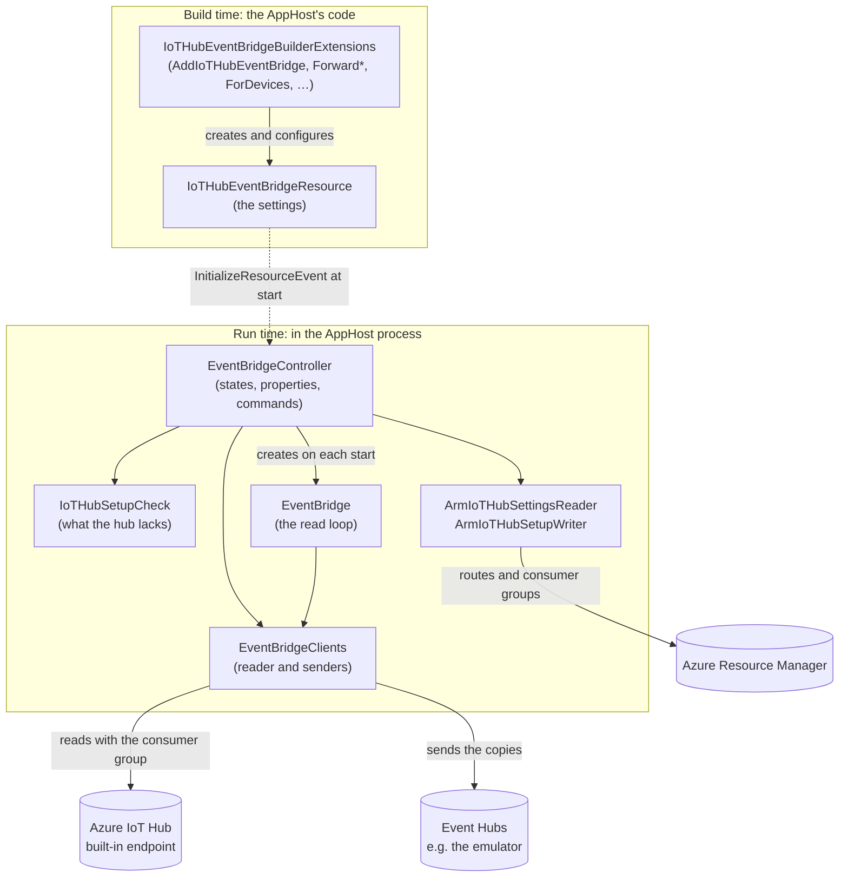
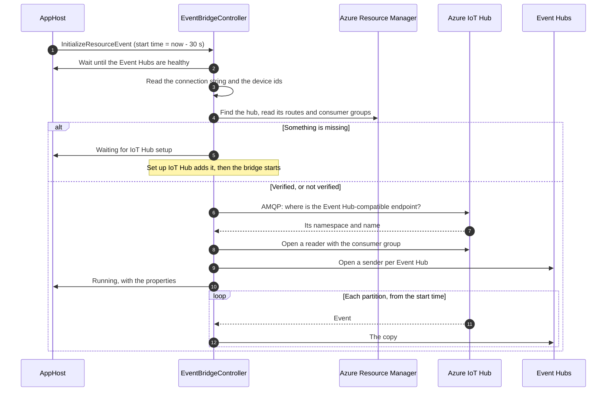
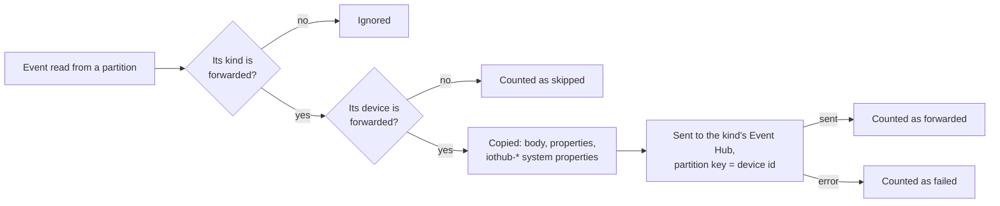
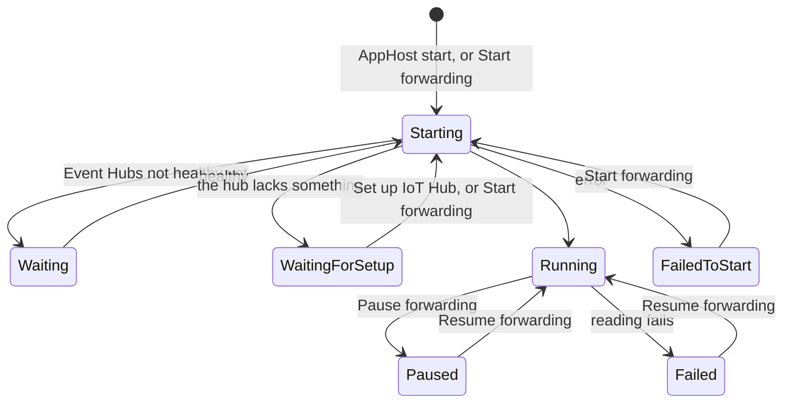

# Introduction

[](https://www.nuget.org/packages/atc.aspire.hosting.azure.iothub)

An [Aspire](https://aspire.dev) hosting integration that forwards the events of a real Azure IoT Hub to Event Hubs of the AppHost, e.g. in the Event Hubs emulator: device lifecycle events, twin change events and telemetry, each to its own Event Hub.

Code that reads IoT Hub events in Azure, such as an Azure Function with an `EventHubTrigger`, can then run locally against the emulator and receive the events of a real device.

- The bridge reads IoT Hub's built-in endpoint with its own consumer group, and copies each event as IoT Hub delivered it: body, application properties and the `iothub-*` system properties.
- It starts reading shortly before the AppHost started, so the events of devices that start with the AppHost aren't missed.
- At start it checks that the IoT Hub delivers the events it needs, and the **Set up IoT Hub** command adds what's missing.

# Table of Content

- [Introduction](#introduction)
- [Table of Content](#table-of-content)
- [Getting Started](#getting-started)
  - [Installation](#installation)
  - [Usage](#usage)
  - [API](#api)
  - [Choosing devices](#choosing-devices)
    - [With an IoT Edge device](#with-an-iot-edge-device)
  - [What the IoT Hub needs](#what-the-iot-hub-needs)
    - [The check at start](#the-check-at-start)
    - [Set up IoT Hub](#set-up-iot-hub)
    - [Hubs that others use](#hubs-that-others-use)
    - [Adding it yourself](#adding-it-yourself)
  - [Choosing an IoT Hub](#choosing-an-iot-hub)
    - [Limits and quota](#limits-and-quota)
  - [Network](#network)
  - [What a forwarded event looks like](#what-a-forwarded-event-looks-like)
  - [Dashboard](#dashboard)
    - [States and commands](#states-and-commands)
    - [Properties](#properties)
  - [Flow](#flow)
    - [Classes](#classes)
    - [Start](#start)
    - [One event](#one-event)
    - [States](#states)
  - [Limitations](#limitations)
- [Requirements](#requirements)
- [How to contribute](#how-to-contribute)

# Getting Started

## Installation

Install the package via NuGet:

```sh
dotnet add package Atc.Aspire.Hosting.Azure.IoTHub
```

## Usage

```csharp
var builder = DistributedApplication.CreateBuilder(args);

// An IoT Hub connection string whose policy has service connect permission, e.g. service or iothubowner.
var iotHubConnectionString = builder.AddParameter("iothub-connection-string", secret: true);

var eventHubs = builder.AddAzureEventHubs("eventhubs").RunAsEmulator();
var lifecycle = eventHubs.AddHub("device-lifecycle-events");
var twinChanges = eventHubs.AddHub("twin-change-events");
var telemetry = eventHubs.AddHub("telemetry");

builder
    .AddIoTHubEventBridge("iothub-events", iotHubConnectionString)
    .ForwardDeviceLifecycleEvents(lifecycle)
    .ForwardTwinChangeEvents(twinChanges)
    .ForwardTelemetry(telemetry)
    .ForDevices("my-device");

await builder.Build().RunAsync();
```

Set the connection string with user secrets:

```powershell
dotnet user-secrets set "Parameters:iothub-connection-string" "HostName=<hub>.azure-devices.net;SharedAccessKeyName=service;SharedAccessKey=<key>"
```

## API

| Method | Description |
| --- | --- |
| `AddIoTHubEventBridge(name, connectionString)` | Adds the bridge. The connection string's policy needs service connect permission. |
| `ForwardDeviceLifecycleEvents(eventHub)` | Forwards the create and delete events of device and module identities. |
| `ForwardTwinChangeEvents(eventHub)` | Forwards the twin change events of devices and modules. |
| `ForwardTelemetry(eventHub)` | Forwards device-to-cloud messages. Several kinds can go to the same Event Hub. |
| `ForDevices(deviceIds)` | Forwards only the events of these devices, given as text or as parameters. See [Choosing devices](#choosing-devices). |
| `ForAllDevices()` | Forwards the events of all devices, the default. |
| `WithConsumerGroup(consumerGroup)` | Reads with another consumer group of the built-in endpoint than `aspire-bridge`. |
| `WithWebSockets()` | Connects to IoT Hub over AMQP over WebSockets (port 443) instead of AMQP (port 5671). |
| `WithExplicitStart()` | Starts the bridge only from the dashboard. |

The bridge waits until the Event Hubs it forwards to are healthy, and runs only with `aspire run`, not in a deployment.

## Choosing devices

The bridge forwards the events of every device in the IoT Hub. On a hub you share with others, forward only your own devices with `ForDevices`:

| How the device gets its id | Tell the bridge with |
| --- | --- |
| A fixed id | `.ForDevices("my-device")` |
| A parameter, e.g. from user secrets | `.ForDevices(deviceIdParameter)`; the value is read when the bridge starts |
| Not passed to the bridge | Nothing: all devices are forwarded |

`ForAllDevices()` goes back to forwarding all devices. The events of the other devices are counted as skipped.

The bridge works with any device, e.g. a microcontroller that sends telemetry to the hub, and needs no IoT Edge device.

### With an IoT Edge device

The bridge doesn't know about devices from [Atc.Aspire.Hosting.Azure.IoTEdge](https://www.nuget.org/packages/Atc.Aspire.Hosting.Azure.IoTEdge); the two packages don't reference each other. In your own AppHost, give the bridge the device's id:

```csharp
// The device id from user secrets (Parameters:edge-device-id), the same for the device and the bridge.
var deviceId = builder.AddParameter("edge-device-id");

builder
    .AddIoTEdgeDevice("edge-device", iotHubConnectionString)
    .WithDeviceId(deviceId);

builder
    .AddIoTHubEventBridge("iothub-events", iotHubConnectionString)
    .ForwardDeviceLifecycleEvents(lifecycle)
    .ForDevices(deviceId);
```

Without `WithDeviceId`, the device id is `<name>-<machine name>`, and the bridge can take it from the device:

```csharp
var device = builder.AddIoTEdgeDevice("edge-device", iotHubConnectionString);

builder
    .AddIoTHubEventBridge("iothub-events", iotHubConnectionString)
    .ForwardDeviceLifecycleEvents(lifecycle)
    .ForDevices(device.Resource.DeviceId);
```

Call `ForDevices` after `WithDeviceId("...")`, because it takes the id as it is at that moment. With a device id parameter, pass the parameter instead: `device.Resource.DeviceId` only gets the parameter's value when the AppHost runs.

## What the IoT Hub needs

IoT Hub only sends lifecycle and twin change events to its built-in endpoint when routes send them there, and the bridge reads with a consumer group that must exist:

| For | The IoT Hub needs |
| --- | --- |
| Every bridge | The consumer group `aspire-bridge` (or the one passed to `WithConsumerGroup`) on the built-in endpoint `events` |
| `ForwardDeviceLifecycleEvents` | An enabled route with source `DeviceLifecycleEvents` to the built-in endpoint |
| `ForwardTwinChangeEvents` | An enabled route with source `TwinChangeEvents` to the built-in endpoint |
| `ForwardTelemetry` | The fallback route enabled, or an enabled route with source `DeviceMessages` to the built-in endpoint |

IoT Hub delivers an event to every route that matches it, so these routes don't take events away from other routes. Keep the fallback route enabled: as soon as a hub has a route, telemetry only reaches the built-in endpoint through the fallback route or a route of its own.

### The check at start

At start, the bridge reads the hub's routes and consumer groups through Azure Resource Manager with your existing Azure sign-in, e.g. from `az login` or Visual Studio. It finds the hub by name with Azure Resource Graph in the subscriptions you can see, and reads `Azure:TenantId` from the AppHost's configuration, as Aspire does, to choose the tenant. The `iothub.setup` property shows the result:

| `iothub.setup` | Meaning | The bridge |
| --- | --- | --- |
| `Verified` | The hub has everything the bridge needs | Forwards |
| `Missing: …` | Something is missing; the state is **Waiting for IoT Hub setup** | Waits. Run **Set up IoT Hub**, or add what's missing yourself and run **Start forwarding** |
| `Not verified: …` | The hub couldn't be read, e.g. without an Azure sign-in, without read access to the hub, or within 30 seconds | Forwards anyway; if events are missing, run **Set up IoT Hub** |

The check is quiet: it never opens a browser.

### Set up IoT Hub

The **Set up IoT Hub** command shows while the bridge waits for the setup, or when the check couldn't read the hub. It:

1. Signs in to Azure, with the browser if there's no existing sign-in.
2. Reads the hub and shows what it lacks, and asks you to confirm.
3. Creates the consumer group, and adds the routes `aspire-bridge-device-lifecycle-events` and `aspire-bridge-twin-change-events` (condition `true`, to the built-in endpoint), or enables the fallback route. It enables a disabled route of the bridge instead of adding another.
4. Checks the hub again, and starts the bridge if it waited.

The command needs a role that may change the hub, e.g. **Contributor** on it. The routes are written with the hub's ETag, so if the hub changed since it was read, the command fails instead of overwriting that change; run it again. Like `az iot hub message-route create`, it writes the hub's routing settings back as a whole; the access policies and their keys stay as they are.

A browser sign-in lasts only for that AppHost run. At the next start, the quiet check may show `Not verified` again; the hub stays set up and the bridge forwards.

### Hubs that others use

The command refuses to change a hub that has custom routing endpoints, or consumer groups on the built-in endpoint other than `$Default` and the bridge's own. Such a hub is probably used by deployed services, whose routes may be managed by Bicep and whose readers would also receive your events. There's no override. Add what's missing yourself if you're sure, or use a hub of your own.

### Adding it yourself

The same setup with the Azure CLI:

```powershell
az iot hub consumer-group create --hub-name <hub> --name aspire-bridge
az iot hub message-route create --hub-name <hub> --route-name aspire-bridge-device-lifecycle-events --source devicelifecycleevents --endpoint-name events --enabled true --condition true
az iot hub message-route create --hub-name <hub> --route-name aspire-bridge-twin-change-events --source twinchangeevents --endpoint-name events --enabled true --condition true
az iot hub message-route fallback set --hub-name <hub> --enabled true
```

Run **Start forwarding** afterwards when the bridge waits for the setup.

## Choosing an IoT Hub

- **A hub of your own on the Free (F1) tier** is the simplest: the bridge can set it up, and nobody else reads its events. Each subscription can have one free hub.
- **A test hub shared with other developers**: let everyone use the default consumer group `aspire-bridge`, and `ForDevices` with their own devices. A consumer group allows 5 readers per partition, so up to 5 developers can run the bridge at the same time. A consumer group of your own makes the hub look used by others to the other developers' **Set up IoT Hub**.
- **A hub that deployed services use** (e.g. DEV): the bridge doesn't change it. Its readers would also receive the events of your local devices.
- A reader that takes ownership of partitions, e.g. an Azure Function or an `EventProcessorClient`, disconnects the bridge if it uses the bridge's consumer group. Never give them the same consumer group.

### Limits and quota

| | F1 | S1 |
| --- | --- | --- |
| Messages a day | 8,000, metered in 0.5 KB chunks | 400,000 per unit, metered in 4 KB chunks |
| Routes | 5 | 100 |
| Consumer groups on the built-in endpoint | 20 | 20 |

The bridge uses 2 routes and 1 consumer group. Reading the built-in endpoint costs no quota, and neither do the lifecycle and twin change events themselves. What causes them still counts, e.g. twin updates, as does the telemetry the devices send. The quota resets at 00:00 UTC.

## Network

The bridge connects to IoT Hub over AMQP on port 5671. On networks that only allow HTTPS, use `WithWebSockets()`: AMQP over WebSockets on port 443, which follows the system's proxy settings.

The bridge first asks IoT Hub, over AMQP, for the address of its Event Hub-compatible endpoint, and then reads that endpoint with the Event Hubs client. Only the IoT Hub connection string is needed.

## What a forwarded event looks like

- The body, the application properties (e.g. `opType`, `deviceId`, `moduleId`, `hubName`) and the properties section (`message-id`, `correlation-id`, `user-id`, `content-type`, `content-encoding`) are copied as IoT Hub delivered them.
- The `iothub-*` system properties are copied too, e.g. `iothub-message-source`, `iothub-connection-device-id`, `iothub-connection-module-id` and `iothub-enqueuedtime`.
- The event's own `EnqueuedTime`, offset and sequence number are the local Event Hub's. IoT Hub's time is the `iothub-enqueuedtime` system property.
- The partition key is the device id, so the events of a device stay in order.

## Dashboard

### States and commands

| State | Commands |
| --- | --- |
| Not started (with `WithExplicitStart`), Failed to start | **Start forwarding** |
| Waiting (for the Event Hubs) | |
| Waiting for IoT Hub setup | **Set up IoT Hub**, **Start forwarding** |
| Running | **Pause forwarding**; **Set up IoT Hub** when the setup is `Not verified` |
| Paused | **Resume forwarding** |
| Failed (reading stopped) | **Resume forwarding** |

**Pause forwarding** and **Resume forwarding** continue after the last event read. The position is kept in memory only: after an AppHost restart, the bridge starts again 30 seconds before the AppHost started.

### Properties

The bridge's properties are in the resource's details: select the bridge on the **Resources** page. The dashboard may hide them until you expand the properties.

| Property | Example |
| --- | --- |
| `iothub.hostName` | `myhub.azure-devices.net` |
| `iothub.transport` | `AMQP (port 5671)` |
| `iothub.consumerGroup` | `aspire-bridge` |
| `iothub.setup` | `Verified` |
| `bridge.startTime` | `2026-11-01 19:00:32Z` |
| `bridge.devices` | `my-device`, or `All devices` |
| `bridge.deviceLifecycleEvents`, `bridge.twinChangeEvents`, `bridge.telemetry` | `twin-change-events: 5 forwarded, 0 skipped, 0 failed` |

The counts update at most once a second. Skipped events belong to devices the bridge doesn't forward; failed events couldn't be sent to the local Event Hub. The log has a line per forwarded event.

## Flow

### Classes



### Start



### One event



A failed send doesn't stop the bridge. A failed read stops it with the state **Failed**; **Resume forwarding** continues after the last event read.

### States



## Limitations

- The check at start doesn't look at route conditions. A route with a condition such as `$body.temperature > 30` counts as present, though it lets only some events through.
- A hub created moments ago may show `Not verified` until Azure Resource Graph has indexed it, which takes about a minute. The bridge forwards anyway.
- Connection state events (device connected or disconnected) aren't forwarded.
- The bridge runs in the AppHost process with `aspire run` only. It isn't deployed.

# Requirements

- [.NET 10 SDK](https://dotnet.microsoft.com/en-us/download/dotnet/10.0)
- [Aspire 13.6 or later](https://aspire.dev/get-started/prerequisites/)
- [An Azure IoT Hub](https://learn.microsoft.com/azure/iot-hub/create-hub)

# How to contribute

[Contribution Guidelines](https://atc-net.github.io/introduction/about-atc#how-to-contribute)

[Coding Guidelines](https://atc-net.github.io/introduction/about-atc#coding-guidelines)